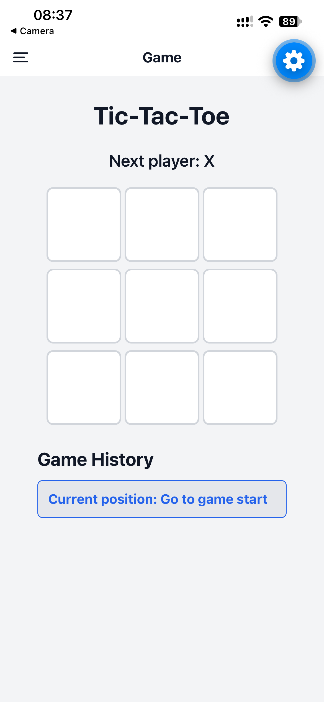
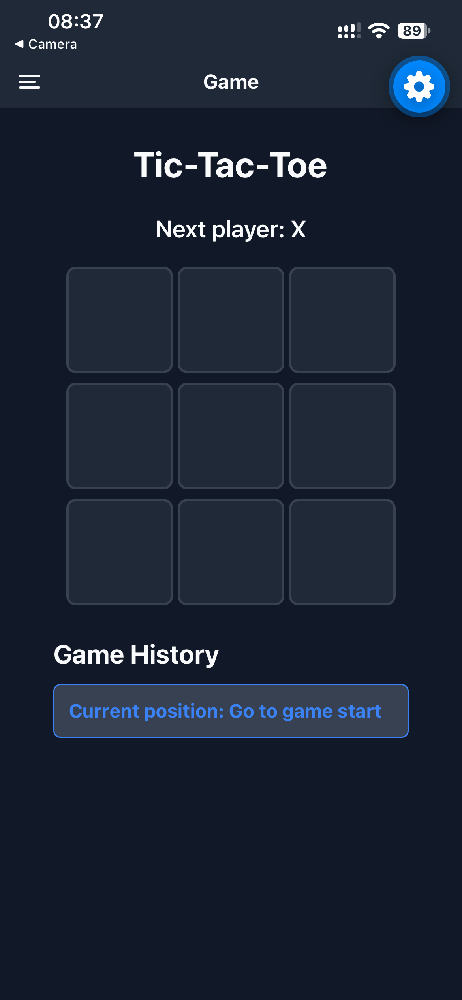

# Tic-Tac-Toe — React Native

## Description

This project is an enhanced Tic-Tac-Toe mobile application built with React Native, TypeScript, Expo, and Expo Router.
It features a 3x3 game board with time travel, drawer navigation, and light/dark theme support powered by React Context.

## Screenshots

<p align="center">
  
  &nbsp;&nbsp;&nbsp;&nbsp;
  
</p>

<p align="center">
  <em>Left: Light Mode &bull; Right: Dark Mode</em>
</p>

## Features

- **3 x 3 Game Board**: Interactive board with two players (X and O).
- **Automatic Winner & Draw Detection**: Real-time detection with winning line highlighting.
- **Restart Button**: Appears when a game finishes (win or draw) to easily reset and start a new game.
- **Game History & Time Travel**: Jump back to any prior move without losing state across screen visits.
- **Drawer Navigation**: Drawer menu with Game, Settings, and About screens (accessible via swipe or header menu button).
- **Light & Dark Themes**: Global theme management via React Context with immediate updates across all screens, headers, drawer, and status bar.
- **Dynamic About Page**: Displays application name and version loaded directly from `app.json`.

## Technologies

- React Native
- TypeScript
- Expo & Expo Router
- React Navigation Drawer

## Installation

1. Clone the repository:
   ```bash
   git clone https://github.com/Mtg221/tic-tac-toe-mobile-app
   ```
2. Enter the project folder:
   ```bash
   cd tic-tac-toe
   ```
3. Install dependencies:
   ```bash
   npm install
   ```
4. Start Expo:
   ```bash
   npx expo start
   ```
5. Open the application using Expo Go on your mobile device.

## Learning Objectives

- Build reusable React Native components
- Manage state with `useState` and global state with React `Context`
- Structure multi-screen navigation using Expo Router Drawer
- Implement cross-platform light and dark themes
- Separate style layout from theme colors
- Store and navigate through game history
